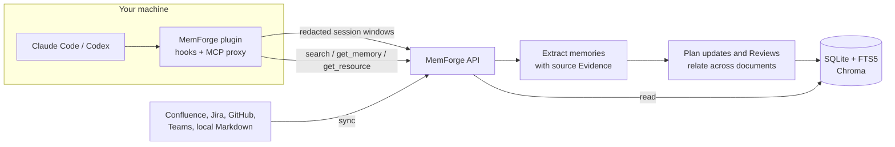

<h1> MemForge</h1>

**Give every agent your team's brain on day one.**

The memory layer for AI agents. Everything your team knows. Cited, and always
up to date. Built from your docs, tickets, chat and agent sessions.

<p>
  <a href="https://github.com/dodo-labs-ai/mem-forge/actions/workflows/ci.yml"></a>
  
  
</p>

<p align="center">
  <picture>
    <source media="(prefers-color-scheme: dark)" srcset="https://raw.githubusercontent.com/dodo-labs-ai/mem-forge/main/.github/assets/demo-dark.gif">
    
  </picture>
</p>

> **Status: beta.** APIs, storage formats and plugin packaging may still change.
> A new release saves a recovery point of the database and vector index before
> it upgrades them, rolls back a migration that fails, and refuses data a newer
> release wrote; restoring the recovery point goes back
> ([Upgrading](https://github.com/dodo-labs-ai/mem-forge/blob/main/docs/quickstart.md#upgrading)).
> The open-source build runs for one user on one machine.

## Quick start

You need Docker with Compose v2 and an API key for a model provider
(OpenRouter, OpenAI or Anthropic), or a model server such as Ollama.

```bash
git clone https://github.com/dodo-labs-ai/mem-forge.git && cd mem-forge
cp .env.example .env
docker compose up --build
```

Open the admin UI at http://localhost:5174 and choose a generation model and an
embedding model in Settings. Then install the agent plugin:

```text
# Claude Code (inside a session)
/plugin marketplace add dodo-labs-ai/mem-forge
/plugin install memory@memforge
```

```bash
# Codex
codex plugin marketplace add dodo-labs-ai/mem-forge
codex plugin add memory@memforge
```

Open **Sources** in the admin UI to connect Confluence, Jira or another source,
then start a new agent session and ask:

```text
Before you change this, check MemForge for decisions and conventions that
apply, and show the source for each one you rely on.
```

From here on, plugin hooks upload eligible session windows, so what you decide
in a session becomes memory too.

The [quickstart](https://github.com/dodo-labs-ai/mem-forge/blob/main/docs/quickstart.md) covers model settings,
[plugin routing](https://github.com/dodo-labs-ai/mem-forge/blob/main/docs/quickstart.md#plugin-routing) for a hosted endpoint or
more than one workspace, local folders, the host CLI and network details.

## Why MemForge

**One memory for your docs and your sessions.** Confluence, Jira, GitHub, Teams
and your Claude Code and Codex sessions land in one store and come back from
one `search` call. From sessions it keeps what you decided or corrected, not
everything the agent said. A decision you made in Claude Code is there when you
open Codex.

**It follows the source.** When a page or ticket changes, the next sync
rechecks the memories built on it. Each one is kept, replaced or retired, or it
waits for your review, and earlier versions keep their history. Across
documents, MemForge marks memories that repeat, update or contradict each
other.

<p align="center">
  
</p>

**Every answer has a source.** `get_memory` returns the supporting text and a
link back to the page, ticket or file. Where the source allows it, the citation
is pinned to the revision and passage that was read, and `get_resource` opens
the original. The supporting text can be the model's focused wording, not
always a verbatim quote.

**Runs on your machine.** Apache-2.0. `docker compose up` starts the service
with local storage (SQLite, FTS5 and Chroma). You bring your own model
endpoints and keys, and those providers receive what is sent for inference.
Session text is redacted in the plugin and again in the service, and raw
conversation windows are not kept.

See [how MemForge compares](https://github.com/dodo-labs-ai/mem-forge/blob/main/docs/comparison.md) with Mem0, Zep, claude-mem and
Unblocked.

## How it works



1. **Capture.** Plugin hooks upload redacted session windows, and connectors
   sync documents.
2. **Extract.** An LLM turns each source into short memories with supporting
   Evidence.
3. **Reconcile.** When a source changes, affected memories are rechecked and
   related ones are linked.
4. **Recall.** Agents call `search`, `get_memory` and `get_resource` over MCP.

More detail: [architecture overview](https://github.com/dodo-labs-ai/mem-forge/blob/main/docs/architecture.md).

## Integrations

MemForge sits between the systems where your team writes things down and the
agents that do the work.

**Agent integrations**

<p>
  &nbsp;Claude&nbsp;Code&nbsp;&nbsp;&nbsp;
  <picture><source media="(prefers-color-scheme: dark)" srcset="https://raw.githubusercontent.com/dodo-labs-ai/mem-forge/main/.github/assets/icons/openai-dark.svg"></picture>&nbsp;Codex
</p>

**Memory sources**

<table>
  <tr>
    <td>Docs and wikis</td>
    <td nowrap>
      &nbsp;Confluence&nbsp;&nbsp;&nbsp;
      <picture><source media="(prefers-color-scheme: dark)" srcset="https://raw.githubusercontent.com/dodo-labs-ai/mem-forge/main/.github/assets/icons/github-dark.svg"></picture>&nbsp;GitHub&nbsp;Pages&nbsp;&nbsp;&nbsp;
      <picture><source media="(prefers-color-scheme: dark)" srcset="https://raw.githubusercontent.com/dodo-labs-ai/mem-forge/main/.github/assets/icons/github-dark.svg"></picture>&nbsp;GitHub&nbsp;repo&nbsp;docs&nbsp;&nbsp;&nbsp;
      &nbsp;Local&nbsp;folders
    </td>
  </tr>
  <tr>
    <td>Tickets</td>
    <td nowrap>&nbsp;Jira</td>
  </tr>
  <tr>
    <td>Chat</td>
    <td nowrap>&nbsp;Teams</td>
  </tr>
  <tr>
    <td>Agent sessions</td>
    <td nowrap>
      &nbsp;Claude&nbsp;Code&nbsp;&nbsp;&nbsp;
      <picture><source media="(prefers-color-scheme: dark)" srcset="https://raw.githubusercontent.com/dodo-labs-ai/mem-forge/main/.github/assets/icons/openai-dark.svg"></picture>&nbsp;Codex
    </td>
  </tr>
  <tr>
    <td>Planned</td>
    <td nowrap>
      &nbsp;Obsidian
    </td>
  </tr>
</table>

[Add a source](https://github.com/dodo-labs-ai/mem-forge/blob/main/docs/quickstart.md#4-add-a-source) lists what each one syncs and
how to scope it. Need one that is missing?
[Open an issue](https://github.com/dodo-labs-ai/mem-forge/issues).

## Limits

- The open-source build is single-user, has no authentication, and binds to
  `127.0.0.1` only. Do not expose it on a network.
- Model extraction and semantic judgments can miss useful knowledge or make
  mistakes. Check the cited Evidence before relying on a consequential claim.
- A generation model is required; without one, syncs store content but create
  no memories.

## Documentation

- [Quickstart](https://github.com/dodo-labs-ai/mem-forge/blob/main/docs/quickstart.md): setup, models, plugins, sources, CLI,
  development from source
- [Docs index](https://github.com/dodo-labs-ai/mem-forge/blob/main/docs/README.md): quickstart, architecture, API and release guides
- [Contributing](https://github.com/dodo-labs-ai/mem-forge/blob/main/CONTRIBUTING.md)

## License

Apache License 2.0. See [LICENSE](https://github.com/dodo-labs-ai/mem-forge/blob/main/LICENSE).
