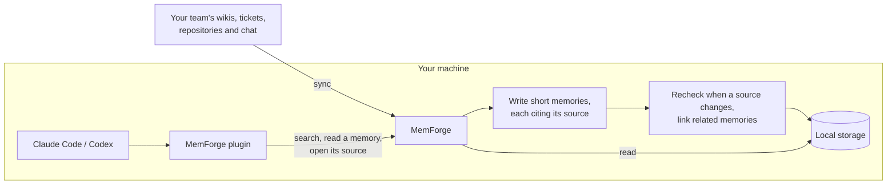
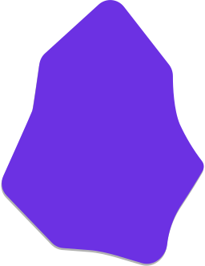

<h1> MemForge</h1>

**Give every agent your team's brain on day one.**

The memory layer for AI agents. Everything your team knows. Cited, and always
up to date. Built from your docs, tickets and chat.

<p>
  <a href="https://github.com/dodo-labs-ai/mem-forge/actions/workflows/ci.yml"></a>
  
  
</p>

<p align="center">
  <picture>
    <source media="(prefers-color-scheme: dark)" srcset="https://raw.githubusercontent.com/dodo-labs-ai/mem-forge/main/.github/assets/demo-dark.gif">
    
  </picture>
</p>

<p align="center">
  The open-source edition runs on your machine. The <b>Team Cloud Edition</b> is on the way:
  we host it and provide the models, your team just subscribes.
  <a href="https://github.com/dodo-labs-ai/mem-forge/discussions/13">Join the waitlist</a>.
</p>

## Why MemForge

- **Turns your team's wiki, tickets and chat into memory your coding agents can
  search.** On its own, a coding agent sees only the local checkout. MemForge syncs
  sources such as Confluence, Jira and Teams ahead of time and builds one memory
  from them, so agents search that memory instead of querying each tool. New sources
  plug into the same
  [connector interface](https://github.com/dodo-labs-ai/mem-forge/blob/main/docs/architecture.md#adding-a-source),
  so the list can keep growing.
- **Continuously detects stale facts and conflicts as your docs change.** Each sync,
  on demand or on a schedule, rechecks the facts taken from changed docs and keeps, replaces
  or retires each one. New facts are also compared with what's already in memory.
  When it finds two docs that disagree, the agent gets both, with a note saying they
  conflict or which is newer.
- **Gives agents precise facts, not documents that blow up their context.** At sync,
  a model turns your sources into memories: precise facts and decisions that keep
  their conditions and exceptions. Agents search them over MCP by keyword, and by
  meaning if you add an embedding model. Search results carry no document text, so a
  full document enters the context only when the agent asks for it.
- **Always justifies each fact with its real source.** Every fact from a source cites
  the passage behind it and, where one exists, links to the original page, ticket or
  file. If no source supports a fact any more, it is retired. The citation can be a
  paraphrase, so MemForge also keeps the source text it read, and you or the agent
  can open it to confirm.
- **Runs on your machine, with team sharing on the way.** The open-source edition
  is Apache-2.0 and single-user, with local storage and your own model keys. Source
  text goes to the model providers you choose, and the agent plugins don't record
  your sessions. The hosted
  [Team Cloud Edition](https://github.com/dodo-labs-ai/mem-forge/discussions/13)
  will give the whole team one shared memory.

## Quick start

> **Beta.** APIs, storage formats and plugin packaging may change. An upgrade
> that migrates your data saves a recovery point first
> ([Upgrading](https://github.com/dodo-labs-ai/mem-forge/blob/main/docs/quickstart.md#upgrading)).

You need Docker with Compose v2 and an API key for OpenRouter, OpenAI or
Anthropic.

**Let your agent set it up.** Paste this into Claude Code or Codex:

```text
Set up MemForge for me. Fetch this guide with curl and follow it exactly:
https://raw.githubusercontent.com/dodo-labs-ai/mem-forge/main/docs/agent-setup.md
```

The agent starts MemForge and installs its plugin, then hands you the admin UI
to enter your model key and connect a source, so your keys never pass through
the agent.

<details>
<summary><b>Or set it up yourself</b> with Docker Compose, in 5 steps</summary>

1. **Start MemForge.**

   ```bash
   git clone https://github.com/dodo-labs-ai/mem-forge.git && cd mem-forge
   cp .env.example .env
   docker compose up --build
   ```

   The admin UI is at http://localhost:5174.

2. **Choose models.** In **Settings**, choose a generation model, which writes
   the memories, and optionally an embedding model for semantic search. After
   **Save and validate**, each one shows **Ready**.

3. **Connect a source.** In **Sources**, add a source, such as a Confluence
   space or a GitHub repository, and run a sync. Turn on
   **Sync automatically** to keep it current. The source shows the memories it
   made as the sync runs.

4. **Install the agent plugin.**

   ```text
   # Claude Code (inside a session)
   /plugin marketplace add dodo-labs-ai/mem-forge
   /plugin install memory@memforge
   ```

   ```bash
   # Codex
   codex plugin marketplace add dodo-labs-ai/mem-forge
   codex plugin add memory@memforge
   ```

5. **Ask.** Start a new agent session in your project and ask:

   ```text
   Before you change this, check MemForge for decisions and conventions that
   apply, and show the source for each one you rely on.
   ```

   The agent answers with the memories that apply and names the source of each.

</details>

The [quickstart](https://github.com/dodo-labs-ai/mem-forge/blob/main/docs/quickstart.md) covers every model provider,
local folders, the host CLI and network details.

## How it works



1. **Sync.** Connectors read your docs, tickets and chat, on a schedule or
   when you ask.
2. **Extract.** A model turns each source into short memories, each citing the
   passage it came from.
3. **Recheck.** When a source changes, the memories built on it are kept,
   replaced or retired, and related memories are linked.
4. **Recall.** Agents search memory and open its sources over MCP.

More detail: [architecture overview](https://github.com/dodo-labs-ai/mem-forge/blob/main/docs/architecture.md).

## Integrations

MemForge sits between the systems where your team writes things down and the
agents that do the work.

**Agent integrations**

<p>
  &nbsp;Claude&nbsp;Code&nbsp;&nbsp;&nbsp;
  <picture><source media="(prefers-color-scheme: dark)" srcset="https://raw.githubusercontent.com/dodo-labs-ai/mem-forge/main/.github/assets/icons/openai-dark.svg"></picture>&nbsp;Codex
</p>

**Memory sources**

<table>
  <tr>
    <td>Docs and wikis</td>
    <td nowrap>
      &nbsp;Confluence&nbsp;&nbsp;&nbsp;
      <picture><source media="(prefers-color-scheme: dark)" srcset="https://raw.githubusercontent.com/dodo-labs-ai/mem-forge/main/.github/assets/icons/notion-dark.svg"></picture>&nbsp;Notion&nbsp;&nbsp;&nbsp;
      <picture><source media="(prefers-color-scheme: dark)" srcset="https://raw.githubusercontent.com/dodo-labs-ai/mem-forge/main/.github/assets/icons/github-dark.svg"></picture>&nbsp;GitHub&nbsp;Pages&nbsp;&nbsp;&nbsp;
      <picture><source media="(prefers-color-scheme: dark)" srcset="https://raw.githubusercontent.com/dodo-labs-ai/mem-forge/main/.github/assets/icons/github-dark.svg"></picture>&nbsp;GitHub&nbsp;repo&nbsp;docs&nbsp;&nbsp;&nbsp;
      &nbsp;Local&nbsp;folders
    </td>
  </tr>
  <tr>
    <td>Tickets</td>
    <td nowrap>&nbsp;Jira</td>
  </tr>
  <tr>
    <td>Chat</td>
    <td nowrap>&nbsp;Teams</td>
  </tr>
  <tr>
    <td>Planned</td>
    <td nowrap>
      &nbsp;Obsidian
    </td>
  </tr>
</table>

[Add a source](https://github.com/dodo-labs-ai/mem-forge/blob/main/docs/quickstart.md#4-add-a-source) lists what each one syncs and
how to scope it. Need one that is missing?
[Vote for the next source](https://github.com/dodo-labs-ai/mem-forge/discussions/12).

## Limits

- The open-source edition runs for one person on one machine. It has no
  accounts or authentication and listens on `127.0.0.1` only, so do not expose
  it on a network. For memory your whole team shares, join the
  [Team Cloud Edition waitlist](https://github.com/dodo-labs-ai/mem-forge/discussions/13).
- Model extraction and semantic judgments can miss useful knowledge or make
  mistakes. Check the cited Evidence before relying on a consequential claim.
- A generation model is required; without one, syncs store content but create
  no memories.

## Documentation

- [Quickstart](https://github.com/dodo-labs-ai/mem-forge/blob/main/docs/quickstart.md): setup, models, plugins, sources, CLI,
  development from source
- [Docs index](https://github.com/dodo-labs-ai/mem-forge/blob/main/docs/README.md): quickstart, architecture, API and release guides
- [How MemForge compares](https://github.com/dodo-labs-ai/mem-forge/blob/main/docs/comparison.md): when to choose MemForge and when
  another tool fits better
- [Contributing](https://github.com/dodo-labs-ai/mem-forge/blob/main/CONTRIBUTING.md)

## License

Apache License 2.0. See [LICENSE](https://github.com/dodo-labs-ai/mem-forge/blob/main/LICENSE).
